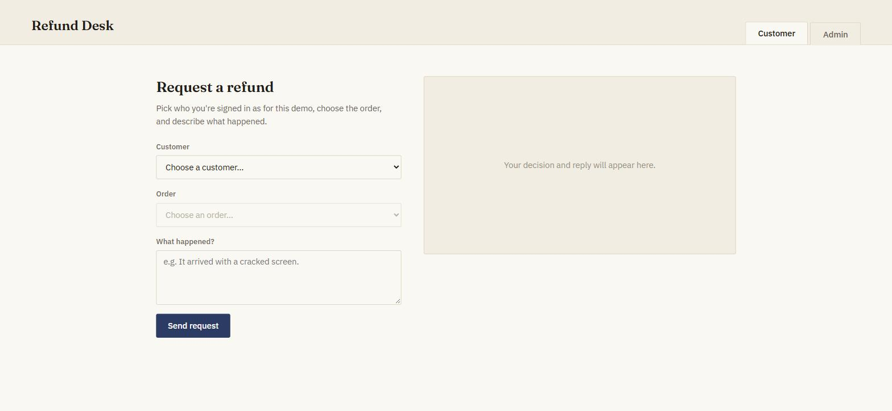
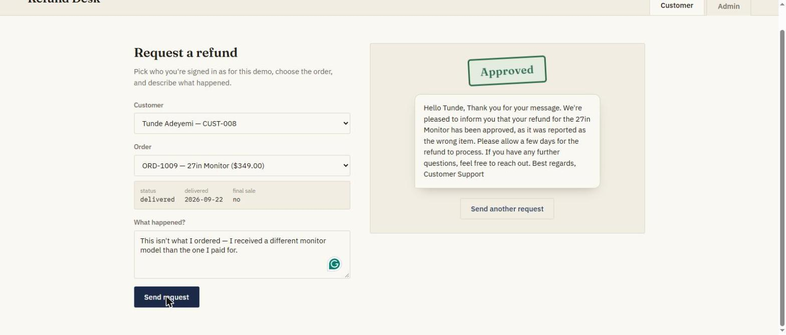
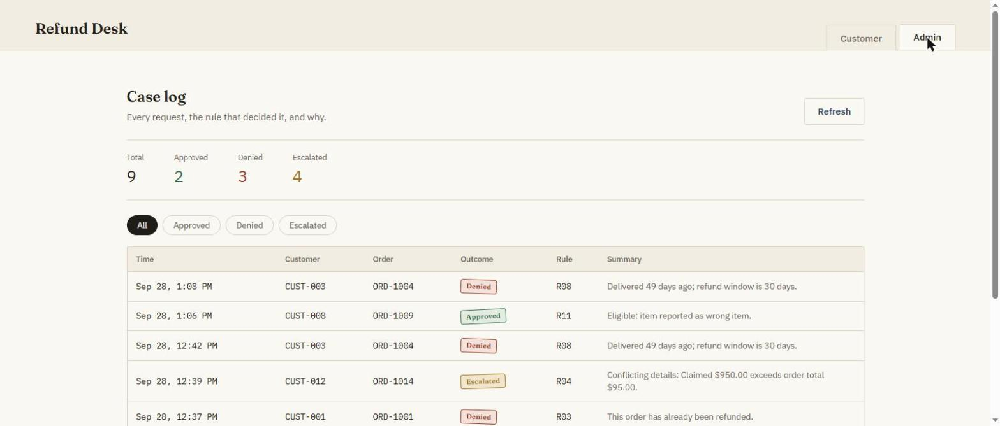
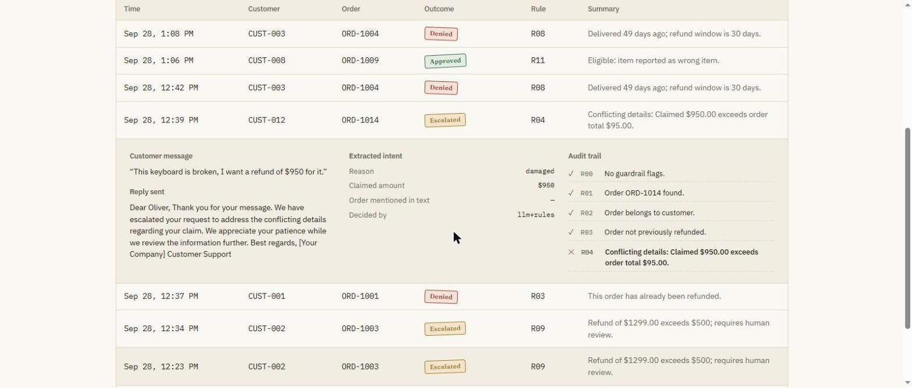

# AI-Powered Refund Desk

A full stack customer-support app that approves, denies, or escalates e-commerce
refund requests using a deterministic policy engine plus an LLM assistant.

## Quick start
```bash
cp .env.example .env        # add OPENAI_API_KEY, or leave empty for rules-only mode
docker-compose up --build
```
- Customer app: http://localhost:3000
- Admin dashboard: http://localhost:3000 (Admin tab)
- API: http://localhost:5000/api/health

The database is seeded automatically on first start with 15 customers and 18
orders, each crafted to exercise a specific policy rule (see
[`backend/app/seed.py`](backend/app/seed.py)).

## Screenshots

| Customer request | AI decision + reply |
|---|---|
|  |  |

| Admin case log | Audit trail detail |
|---|---|
|  |  |

## Architecture
```
┌────────────────────┐        ┌──────────────────────────────────────────────┐
│  frontend (React)  │  HTTP  │  backend (Flask API)                         │
│  ─────────────────  │ ─────▶ │  ┌────────────────────────────────────────┐ │
│  Customer request   │        │  │ guardrails.screen()                   │ │
│  form + AI reply     │        │  │  → regex prompt-injection screen      │ │
│                      │        │  └───────────────┬────────────────────────┘ │
│  Admin case log      │        │                  ▼                          │
│  (outcomes + audit   │        │  ┌────────────────────────────────────────┐ │
│   trail per request) │        │  │ llm_client.extract_intent()           │ │
└────────────────────┘        │  │  → LLM reads the message, returns      │ │
                                │  │    validated JSON (reason, amount,     │ │
                                │  │    mentioned order). Never the DB.     │ │
                                │  └───────────────┬────────────────────────┘ │
                                │                  ▼                          │
                                │  ┌────────────────────────────────────────┐ │
                                │  │ policy_engine.evaluate()               │ │
                                │  │  → PURE function, DB facts only.       │ │
                                │  │    Decides APPROVED/DENIED/ESCALATED. │ │
                                │  │    The only component that decides.    │ │
                                │  └───────────────┬────────────────────────┘ │
                                │                  ▼                          │
                                │  ┌────────────────────────────────────────┐ │
                                │  │ llm_client.draft_reply()               │ │
                                │  │  → LLM writes the customer-facing      │ │
                                │  │    reply from the FINAL decision.      │ │
                                │  │    It cannot change the outcome.       │ │
                                │  └───────────────┬────────────────────────┘ │
                                │                  ▼                          │
                                │       RefundRequest row (SQLite)           │
                                │       message, extracted intent, outcome, │
                                │       rule id, full check-by-check audit  │
                                │       trail, guardrail flags, reply       │
                                └──────────────────────────────────────────────┘
```

**Clean separation:** `routes/` (HTTP) → `services/refund_service.py`
(orchestration) → `services/policy_engine.py` (pure decision logic, no I/O) +
`services/llm_client.py` (AI layer, isolated behind two narrow functions) +
`models.py` (data). The policy engine has no knowledge of Flask, the LLM, or
HTTP; it takes plain dataclasses in and returns a `Decision`, so it's trivial
to unit test and impossible for the AI layer to reach around it.

## Key design principle
**The LLM assists; it never decides.**

1. **Guardrails** screen the message for prompt-injection patterns (`ignore
   previous instructions`, `act as admin`, delimiter-breaking tags, etc.) and
   cap its length.
2. **The LLM extracts** a structured intent (reason category, claimed amount,
   any order ID mentioned in the text), validated against a Pydantic schema —
   invalid or missing output falls back to keyword matching.
3. **The policy engine decides** using database facts only (order amount,
   delivery date, final-sale flag, refund history). The customer's claimed
   amount can only ever *escalate* a request (if it conflicts with the order
   total), never approve one.
4. **The LLM drafts** a customer reply from the final decision; it's told the
   outcome is final and not to soften or change it. A template reply is used
   if the LLM is unavailable.
5. **Every check is logged** — pass/fail per rule, guardrail flags, the raw
   extracted intent, and who decided (`llm+rules` vs `rules-only`) — and shown
   on the admin dashboard.

If the API key is missing or the LLM returns invalid output, the system falls
back to keyword classification and template replies, so it always works.

The customer selects the order from a dropdown in the UI — the order ID is
never parsed from free text. If the message mentions a *different* order ID,
that's treated as a conflict and escalated (`R04`), regardless of what the
LLM extracted.

## Frontend
Two views in one React (Vite) app, talking to the API over CORS:
- **Customer** — pick a demo customer, pick one of their orders, describe the
  issue, and submit. The outcome renders as a stamp (Approved / Denied /
  Escalated) with the AI-drafted reply below it.
- **Admin** — a case log of every request with outcome counts, a filter by
  outcome, and an expandable row per request showing the customer's message,
  the reply sent, the extracted intent, guardrail flags, and the full
  rule-by-rule audit trail.

## API
| Method | Path | Purpose |
|---|---|---|
| GET | /api/health | Status + whether LLM is enabled |
| GET | /api/customers | Demo customers |
| GET | /api/customers/:id/orders | A customer's orders |
| POST | /api/refund-requests | Submit `{customer_id, order_id, message}` |
| GET | /api/refund-requests?outcome= | Admin list |
| GET | /api/refund-requests/:id | Full audit detail |
| GET | /api/stats | Counts by outcome |

## Environment variables
Set in `.env` (see `.env.example`), read by `docker-compose.yml`:
| Variable | Purpose | Default |
|---|---|---|
| `OPENAI_API_KEY` | Enables the LLM layer. Empty = rules-only mode. | *(empty)* |
| `LLM_MODEL` | OpenAI model name. | `gpt-4o-mini` |
| `CORS_ORIGINS` | Allowed origins for the API. | `*` |
| `VITE_API_URL` | API base URL baked into the frontend build; the **browser** calls this directly. | `http://localhost:5000/api` |

## Running locally without Docker
```bash
# backend
cd backend && pip install -r requirements.txt
flask --app wsgi run           # http://localhost:5000

# frontend, in another terminal
cd frontend && npm install
npm run dev                    # http://localhost:5173
```

## Tests
```bash
cd backend && pip install -r requirements.txt && pytest -q
```
38 tests: policy engine (every rule, boundary conditions), guardrails
(injection patterns, delimiting), and end-to-end API tests against the seeded
demo scenarios.

## Refund policy
See [`backend/policy/refund_policy.md`](backend/policy/refund_policy.md) for
the human-readable rules; each is implemented and unit-tested in
[`backend/app/services/policy_engine.py`](backend/app/services/policy_engine.py).

## Assumptions and trade-offs
- **Demo login selector, not real auth.** The customer "signs in" by picking
  themselves from a dropdown. Out of scope for a 6-8 hour assessment; a real
  system would authenticate the session and derive `customer_id` from it
  server-side rather than trusting the request body.
- **The order is selected in the UI, not parsed from text**, so the LLM can't
  be tricked into targeting a different order than the one the customer
  picked.
- **Refunds are full-order only** — no partial-item or partial-amount
  refunds.
- **SQLite** keeps setup to a single command; swapping to Postgres only needs
  a `DATABASE_URL` env var, since the app talks to it through SQLAlchemy.
- **Regex-based guardrails can false-positive** on legitimate messages that
  happen to contain phrases like "ignore" — the cost of a false positive is
  only an escalation to human review, never a wrongly-approved refund, so the
  screen is intentionally tuned to be a little trigger-happy.
- **The frontend build bakes in `VITE_API_URL`** rather than reading it at
  runtime, since it's a static Vite/Nginx bundle. Fine for local/demo use;
  a production deploy would front the API with a reverse proxy on the same
  origin instead.
